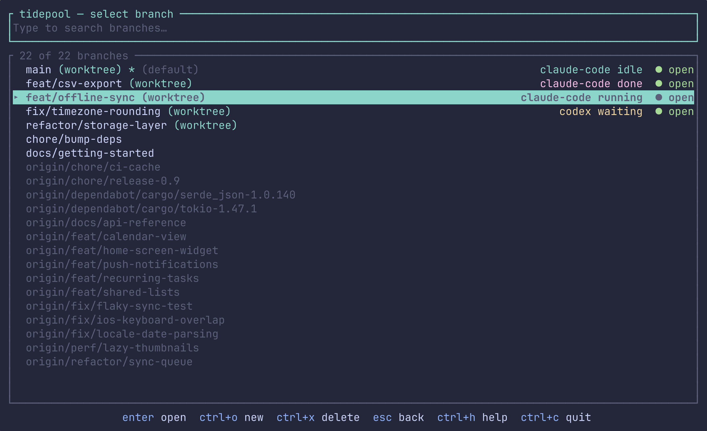

# kiosk

Kiosk is a Git-aware tmux session manager, which shows the status of your AI agents (waiting for permission, running, idle or done).

Search for the repo you want, and optionally select a branch or create a new one. If a session already exists, you jump straight in - if it doesn't, a new session is created, with a new worktree if needed.



Worktrees are created in `~/.kiosk/worktrees/<repo>/<branch>` by default; set [`worktrees.directory`](#worktrees) to put them elsewhere.


## Usage

### Picker

Add a keybinding to your `tmux.conf` to run `kiosk` in a popup (the following uses `<prefix> f`, but change as appropriate):

```tmux
bind-key f display-popup -xC -yC -w90% -h90% -d "#{pane_current_path}" -E "kiosk"
```

You'll start in the repo view, which shows all repos in the folders defined in your config:
- Start typing to fuzzy search across repos
- Enter opens the repo with the primary checkout
- Tab opens the branch view for that repo

From the branch view, you can again fuzzy match across branches:
- Enter opens a session in a worktree on that branch, either switching to an existing session if one exists, or creating a new one otherwise
- `ctrl+o` creates a new branch named after your search, in a new worktree
- `ctrl+x` removes a branch's worktree and closes its session

`ctrl+h` shows every binding for the current view. Run outside tmux, kiosk attaches to the session you pick once the picker closes.

Sessions kiosk creates are named after the repo and branch (`my-project/feat-thing`), but kiosk finds them by the folder they show, so renaming them is fine. Sessions you made yourself count as showing the folder they were started in.

### Agent status

Rows for checkouts that are open in tmux show what the agents in their sessions are doing, such as `claude waiting` or `codex running`. Kiosk reads this from two places:

- Programs that report their own status with the [Program Status Protocol (OSC 7501)](https://mitchellh.com/writing/program-status-osc7501). tmux shows these reports to nobody, so kiosk pipes the output of each pane to a small collector (`tmux pipe-pane`) and sets global tmux hooks so new panes get one too. tmux allows one pipe per pane, so panes you already pipe elsewhere are left alone. Kiosk starts collecting the first time it runs in a tmux server, so set [`agent.osc7501`](#agent) to `false` if you'd rather it didn't.
- For panes without such reports, the screens of Claude Code, Codex, Cursor, Gemini CLI and OpenCode, which kiosk recognises.

To jump to the agent that has waited longest for you, bind `kiosk next`, which switches to the least recently active other session with an agent that is waiting, done, idle or in an unknown state:

```tmux
bind-key n run-shell "kiosk next"
```

`kiosk agents` lists every agent kiosk can see, which helps when a status looks wrong; add `--json` for scripts.

### Config

On first launch (when no config file exists), you'll see a setup wizard to create your config file. If you'd rather do this manually, see the [configuration](#configuration) section.


## Installing

### Homebrew

```sh
brew install thomasschafer/tap/kiosk
```

### Cargo

Ensure you have the Rust toolchain installed, then run:

```sh
cargo install kiosk
```

### Prebuilt binaries

Download the appropriate binary for your system from the [releases page](https://github.com/thomasschafer/kiosk/releases/latest):

| Platform | Architecture | Download file |
|-|-|-|
| Linux | Intel/AMD | `*-x86_64-unknown-linux-musl.tar.gz` |
| Linux | ARM64 | `*-aarch64-unknown-linux-musl.tar.gz` |
| macOS | Apple Silicon| `*-aarch64-apple-darwin.tar.gz` |
| macOS | Intel | `*-x86_64-apple-darwin.tar.gz` |
| Windows | x64 | `*-x86_64-pc-windows-msvc.zip` |

After downloading, extract the binary and move it to a directory in your `PATH`.

### Building from source

Ensure you have the Rust toolchain installed, then pull down the repo and run:

```sh
cargo install --path kiosk
```


## Configuration

Here's a minimal example that contains all required keys (change values as appropriate):

```toml
search_dirs = ["~/Development"]
```

<!-- CONFIG:START -->
Kiosk reads `$XDG_CONFIG_HOME/kiosk/config.toml`, which is
`~/.config/kiosk/config.toml` when `XDG_CONFIG_HOME` is unset, or `config.toml` in
`$KIOSK_CONFIG_DIR` when that is set. All sections are optional, and the defaults are
shown below alongside curated examples for settings that benefit from one.

#### `search_dirs`

Directories searched recursively for Git repositories and, when enabled,
plain folders. Entries can be simple strings such as `"~/Code"` or inline
tables such as `{ path = "~/Work", depth = 3 }`, and both forms can be mixed.
Missing directories are reported as warnings unless marked `optional`.

Example:

```toml
include_non_git = false
search_dirs = [
  "~/Code",
  { path = "~/Work", depth = 2, include_non_git = true },
  { path = "~/Clients", optional = true },
]
```

A repository search root, written either as a path string or an inline table.

Accepted forms:

- String form.
  - Directory to scan with the default depth of 1. `~` and paths beginning with `~/` expand from the user's home directory.
- A path with optional per-directory scan depth, plain-folder override, and missing-directory tolerance.
  - `path` — Directory to scan. `~` and paths beginning with `~/` expand from the user's home directory; other relative paths are accepted as written.
  - `depth` — Maximum directory depth to scan. The value must be at least 1 and defaults to 1 when omitted.
  - `include_non_git` — Whether to include plain folders for this search root. When omitted, the global `include_non_git` value is used.
  - `optional` — Whether this directory may be absent. A missing optional directory is skipped without a warning; a path that exists but is not a readable directory still warns. Defaults to `false`.

#### `include_non_git`

Include plain folders in search results globally. Rich search-directory
entries can override this value with their own `include_non_git` setting.

Default: `false`

### `[worktrees]`

Configure worktree placement.

Where kiosk creates checkouts for branches that do not have one.

#### `directory`

Directory holding new checkouts, each at `<directory>/<repository>/<branch>`.
`~` and paths beginning with `~/` expand from the user's home directory; the path
must be absolute after expansion.

Default: `"~/.kiosk/worktrees"`

### `[on_open]`

Configure command panes created after kiosk creates a session.

The section is optional and contains no pane definitions by default.

Example:

```toml
[on_open]
panes = [
  { command = "hx", direction = "right" },
]
```

#### `panes`

Pane definitions, created in order without moving focus from the first pane.
Commands run from the opened repository or worktree. They run only when kiosk
creates a session, not when it switches to an existing one.

A command pane split off a new session's first pane.

Each entry is an inline table with:

- `command` — Shell command typed into the new pane's shell, which stays when the command ends. The command must not be empty.
- `direction` — Split direction: `right` or `down`.
- `ratio` — Fraction of the split occupied by the new command pane. The value must be greater than 0 and less than 1, and defaults to 0.5 when omitted.

### `[agent]`

Configure agent status.

Agent status is shown beside open checkouts and used by `kiosk next`.

#### `enabled`

Whether to show agent status at all. Set to `false` to stop kiosk looking at
panes.

Default: `true`

#### `osc7501`

Whether to read the status programs report over OSC 7501. Kiosk pipes each pane's
output (`pipe-pane`) to a small collector and sets global tmux hooks so new panes
get one; panes you already pipe elsewhere are left alone. Set to `false` to turn
this off, which also removes kiosk's hooks and collectors the next time kiosk runs.
Panes without OSC 7501 status fall back to recognising known agents' screens.

Default: `true`

#### `poll_interval_ms`

Milliseconds between status refreshes while the picker is open. The value must be
at least 100.

Default: `500`

### `[theme]`

Customize terminal-palette colors used by the picker. Light-terminal users
can set `muted`, `border`, and other colors explicitly.

Colors use the terminal's ANSI palette and can be `black`, `red`, `green`, `yellow`, `blue`, `magenta`, `cyan`, `white`, `gray`, `dark_gray`, `reset`.

Defaults:

```toml
[theme]
accent = "magenta"
secondary = "cyan"
tertiary = "green"
error = "red"
warning = "yellow"
muted = "dark_gray"
border = "dark_gray"
hint = "blue"
highlight_fg = "black"
open = "green"
```

### `[keys]`

Customize key bindings grouped by where they are active.

Assign a key to `"noop"` to unbind an inherited mapping.

Write chords with lowercase `ctrl+`, `alt+`, and `shift+` modifiers followed by a character or a named key such as `enter`, `esc`, `tab`, `backspace`, `delete`, an arrow, `home`, `end`, `pageup`, `pagedown`, or `space`.

Defaults:

```toml
[keys.general]
"ctrl+c" = "quit"
"ctrl+h" = "help"
"ctrl+x" = "dismiss_toast"

[keys.text_edit]
"alt+backspace" = "delete_word"
"backspace" = "backspace"
"ctrl+w" = "delete_word"
"esc" = "clear"
"left" = "cursor_left"
"right" = "cursor_right"

[keys.list_navigation]
"ctrl+n" = "move_down"
"ctrl+p" = "move_up"
"down" = "move_down"
"up" = "move_up"

[keys.modal]
"enter" = "open"
"esc" = "back"

[keys.repo_select]
"enter" = "open"
"q" = "quit"
"tab" = "branches_view"

[keys.branch_select]
"ctrl+o" = "new_branch"
"ctrl+x" = "delete"
"enter" = "open"
"esc" = "back"

```

<!-- CONFIG:END -->
