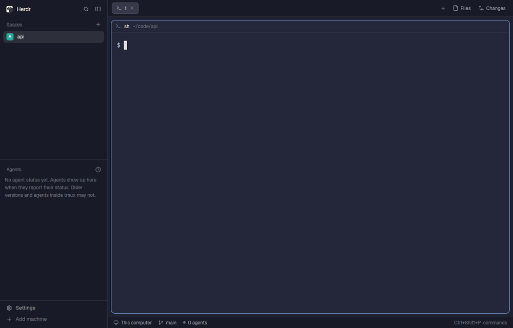

# herdr-app-kiosk

Fuzzy-find your Git repositories (or any folder) and their branches in the
[Herdr](https://herdr.dev) desktop app, then open them as spaces and worktrees.



## Install

### From the mod gallery

Kiosk is in the [mod gallery](https://herdr.dev/gallery/?type=mods). Ask your agent:

```text
Read ~/.config/herdr-app/AGENTS.md, then add this mod: https://github.com/thomasschafer/herdr-app-kiosk
```

The [recipe](RECIPE.md) tells it to fetch the mod's `herdr-app-kiosk` program for your
computer and check it before installing anything.

### With the install script

On macOS and Linux:

```sh
curl -fsSL https://raw.githubusercontent.com/thomasschafer/herdr-app-kiosk/main/scripts/install.sh | sh
```

On Windows, in PowerShell:

```powershell
irm https://raw.githubusercontent.com/thomasschafer/herdr-app-kiosk/main/scripts/install.ps1 | iex
```

The script installs the latest release's mod and prebuilt binary together in the app's
`mods/kiosk` folder. It checks both against the release's `SHA256SUMS` and, if the
[GitHub CLI](https://cli.github.com) is installed and logged in, against the release's build
attestations, which show that this repository's release workflow built them. Pass
`--version v0.1.0` (or set `KIOSK_INSTALL_VERSION` on Windows) for a particular release, and
run it again to update.
Read the [shell script](scripts/install.sh) or [PowerShell script](scripts/install.ps1)
first if you prefer.

### From source

```sh
git clone https://github.com/thomasschafer/herdr-app-kiosk.git
cd herdr-app-kiosk
scripts/install.sh --from-source
```

On Windows, run `scripts\install.ps1 -FromSource`. To work on kiosk, link the mod folder
instead, so the app runs this checkout's own build and each `cargo build --release` takes
effect the next time kiosk opens:

```sh
cargo build --release
ln -s "$PWD/mods/kiosk" ~/.config/herdr-app/mods/kiosk
```

### Open it

Bind a key to open kiosk in `~/.config/herdr-app/keys.json`, for example:

```json
{ "global": { "cmd-k": "mod.open:kiosk" } }
```

## Usage

Type to search, and press `enter` or click to open. `tab` lists its branches; typing a name no branch has and pressing `enter`
starts a new branch, from a base you pick. `ctrl+x`, or a worktree's Remove button, removes
its checkout after asking (the branch stays). `esc` goes back and closes
from the repository list, and `ctrl+u` clears the search. `ctrl+h` lists every key: they can be modified via the
[`[keys]`](#keys) config.

The first time kiosk opens, a setup wizard asks which folders to search and writes the
config.

If you used kiosk in the app through herdr-kiosk before, its config moves here on its own:
kiosk copies `~/.config/herdr-kiosk/config.toml` to `~/.config/herdr-app-kiosk/config.toml`
the first time it opens, and says so, leaving out `[theme]` as kiosk follows the app's theme.

## Configuration

<!-- CONFIG:START -->
Kiosk reads `$XDG_CONFIG_HOME/herdr-app-kiosk/config.toml`, which is
`~/.config/herdr-app-kiosk/config.toml` when `XDG_CONFIG_HOME` is unset, and the setup
wizard writes it the first time kiosk opens. All sections are optional, and the defaults
are shown below alongside curated examples for settings that benefit from one.

#### `search_dirs`

Directories searched recursively for Git repositories and, when enabled,
plain folders. Entries can be simple strings such as `"~/Code"` or inline
tables such as `{ path = "~/Work", depth = 3 }`, and both forms can be mixed.
Missing directories are reported as warnings unless marked `optional`.

Example:

```toml
include_non_git = false
search_dirs = [
  "~/Code",
  { path = "~/Work", depth = 2, include_non_git = true },
  { path = "~/Clients", optional = true },
]
```

A repository search root, written either as a path string or an inline table.

Accepted forms:

- String form.
  - Directory to scan with the default depth of 1. `~` and paths beginning with `~/` expand from the user's home directory.
- A path with optional per-directory scan depth, plain-folder override, and missing-directory tolerance.
  - `path` — Directory to scan. `~` and paths beginning with `~/` expand from the user's home directory; other relative paths are accepted as written.
  - `depth` — Maximum directory depth to scan. The value must be at least 1 and defaults to 1 when omitted.
  - `include_non_git` — Whether to include plain folders for this search root. When omitted, the global `include_non_git` value is used.
  - `optional` — Whether this directory may be absent. A missing optional directory is skipped without a warning; a path that exists but is not a readable directory still warns. Defaults to `false`.

#### `include_non_git`

Include plain folders in search results globally. Rich search-directory
entries can override this value with their own `include_non_git` setting.

Default: `false`

### `[on_open]`

Configure command panes created after opening a new workspace.

The section is optional and contains no pane definitions by default.

Example:

```toml
[on_open]
panes = [
  { command = "hx", direction = "right" },
]
```

#### `panes`

Pane definitions, created in order without moving focus from the primary
pane. Commands run from the opened repository or worktree. They run only
when a workspace is newly opened, not when an existing workspace is focused.

A command pane created after a new workspace is opened.

Each entry is an inline table with:

- `command` — Shell command Herdr runs in the opened checkout. The command must not be empty.
- `direction` — Split direction: `right` or `down`.
- `ratio` — Fraction of the resulting split occupied by the new command pane. The value must be greater than 0 and less than 1, and defaults to 0.5 when omitted. The Herdr app always splits in half, so here it is ignored, which kiosk says when it opens.

### `[keys]`

Customize key bindings grouped by where they are active.

Assign a key to `"noop"` to unbind an inherited mapping.

Write chords with lowercase `ctrl+`, `alt+`, and `shift+` modifiers followed by a character or a named key such as `enter`, `esc`, `tab`, `backspace`, `delete`, an arrow, `home`, `end`, `pageup`, `pagedown`, or `space`.

Each section accepts these actions:

- `[keys.general]`: `noop`, `quit`, `help`, `dismiss_toast`, `scan_warnings`
- `[keys.text_edit]`: `noop`, `clear`, `backspace`, `delete_forward`, `delete_word`, `delete_word_forward`, `delete_to_end`, `cursor_left`, `cursor_right`, `cursor_word_left`, `cursor_word_right`, `cursor_start`, `cursor_end`
- `[keys.list_navigation]`: `noop`, `move_up`, `move_down`
- `[keys.modal]`: `noop`, `open`, `back`
- `[keys.repo_select]`: `noop`, `open`, `branches_view`, `quit`
- `[keys.branch_select]`: `noop`, `open`, `back`, `new_branch`, `delete`, `backspace`, `backspace_or_back`

What each action does:

- `noop` — Unbound
- `quit` — Quit the picker
- `help` — Show active key bindings
- `dismiss_toast` — Dismiss the visible notification
- `scan_warnings` — Show directories that could not be scanned
- `clear` — Clear the search query
- `backspace` — Delete the previous character
- `delete_forward` — Delete the next character
- `delete_word` — Delete the previous word
- `delete_word_forward` — Delete the next word
- `delete_to_end` — Delete to the end
- `cursor_left` — Move the cursor left
- `cursor_right` — Move the cursor right
- `cursor_word_left` — Move the cursor back a word
- `cursor_word_right` — Move the cursor forward a word
- `cursor_start` — Move the cursor to the start
- `cursor_end` — Move the cursor to the end
- `move_up` — Move selection up
- `move_down` — Move selection down
- `open` — Open or confirm the selection
- `back` — Go back or cancel
- `branches_view` — Browse repository branches
- `new_branch` — Create a new branch
- `delete` — Delete the selected checkout
- `backspace_or_back` — Delete the previous character, or go back when the search is empty

Defaults:

```toml
[keys.general]
"ctrl+c" = "quit"
"ctrl+h" = "help"
"ctrl+s" = "scan_warnings"
"f1" = "help"

[keys.text_edit]
"alt+b" = "cursor_word_left"
"alt+backspace" = "delete_word"
"alt+d" = "delete_word_forward"
"alt+delete" = "delete_word_forward"
"alt+f" = "cursor_word_right"
"alt+left" = "cursor_word_left"
"alt+right" = "cursor_word_right"
"backspace" = "backspace"
"ctrl+a" = "cursor_start"
"ctrl+b" = "cursor_left"
"ctrl+d" = "delete_forward"
"ctrl+e" = "cursor_end"
"ctrl+f" = "cursor_right"
"ctrl+k" = "delete_to_end"
"ctrl+left" = "cursor_word_left"
"ctrl+right" = "cursor_word_right"
"ctrl+u" = "clear"
"ctrl+w" = "delete_word"
"delete" = "delete_forward"
"end" = "cursor_end"
"home" = "cursor_start"
"left" = "cursor_left"
"right" = "cursor_right"

[keys.list_navigation]
"ctrl+n" = "move_down"
"ctrl+p" = "move_up"
"down" = "move_down"
"up" = "move_up"

[keys.modal]
"enter" = "open"
"esc" = "back"

[keys.repo_select]
"enter" = "open"
"esc" = "quit"
"tab" = "branches_view"

[keys.branch_select]
"backspace" = "backspace_or_back"
"ctrl+o" = "new_branch"
"ctrl+x" = "delete"
"enter" = "open"
"esc" = "back"

```

<!-- CONFIG:END -->

## How it works

The mod runs `herdr-app-kiosk serve`, which starts the picker in the background and prints a
loopback port and a secret. The mod connects, sends what you press and click, and draws the
views the picker sends back. The picker is kiosk's own Rust state machine, served by
[kiosk-serve](https://github.com/thomasschafer/kiosk), so the behaviour and wording are the
same as kiosk's in a terminal. It ends when the popup closes, however the popup closes.

## Development

```sh
cargo test
scripts/test-install.sh
scripts/app-sandbox/run.sh e2e
```

[`scripts/app-sandbox`](scripts/app-sandbox) runs the released Herdr app headless in Docker
and drives kiosk with real key presses and clicks, checking what it shows and what the app
does. `run.sh record` records the preview above. `cargo xtask readme` regenerates the
configuration reference from the config's doc comments.

A release is a `v*` tag on `main` whose version matches `Cargo.toml` and the mod's
`VERSION`. Its workflow builds the binaries, packs the mod, writes `SHA256SUMS`, attests them
all and publishes the release.
