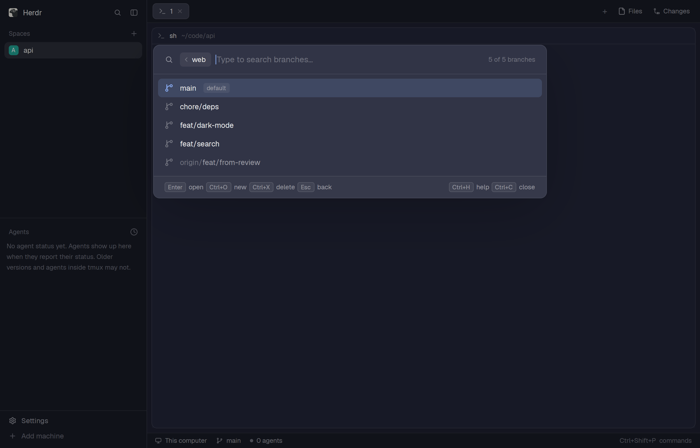

# Kiosk

A fuzzy finder for your Git repositories and their branches, opened over the window like the
app's own pickers. Type to filter, press Enter or click, and kiosk opens the repository as a
space, or the branch in its own worktree and space, making the worktree and the branch if they
don't exist yet. It can also remove a branch's worktree. The picker is a Rust program,
`herdr-app-kiosk`, which the mod starts and draws.

## Before you add it

The mod is only the picker's face: it needs the `herdr-app-kiosk` program of the same release,
in the mod folder's `bin/`. Without it, opening kiosk shows "Kiosk isn't installed".

1. Read the release the mod is from: `VERSION` near the top of `mods/kiosk/main.js`, such as
   `0.1.0`, whose release is tagged `v0.1.0` at
   <https://github.com/thomasschafer/herdr-app-kiosk/releases>.
2. Download that release's `SHA256SUMS` and the binary for this computer,
   `herdr-app-kiosk-v<version>-<target>`, where the target is `aarch64-apple-darwin`,
   `x86_64-apple-darwin`, `x86_64-unknown-linux-gnu`, `aarch64-unknown-linux-gnu` or, on
   Windows, `x86_64-pc-windows-msvc` with `.exe` on the end. Other computers have no prebuilt
   binary: build it from a clone with `cargo build --release` instead.
3. Check its SHA-256 against its line in `SHA256SUMS`, and stop if it differs. With the GitHub
   CLI, logged in, also check that this repository's release workflow built it for that tag,
   and stop if it refuses:
   `gh attestation verify <file> --repo thomasschafer/herdr-app-kiosk --signer-workflow
   thomasschafer/herdr-app-kiosk/.github/workflows/release.yml --source-ref
   refs/tags/v<version> --deny-self-hosted-runners`.
4. After copying the mod folder, put the binary in it as `mods/kiosk/bin/herdr-app-kiosk`
   (`herdr-app-kiosk.exe` on Windows) and make it executable. `herdr-app-kiosk --version`
   should print the same version.

`scripts/install.sh` (or `scripts/install.ps1` on Windows) does all of this, mod included, if
the person prefers to run it themselves.

Tell the person what kiosk does on their computer before adding it:

- The mod runs `bin/herdr-app-kiosk serve` and talks to it over a socket on `127.0.0.1` only,
  using a secret it is handed; that program stops when the popup closes.
- `herdr-app-kiosk` reads the folders the person chooses to search, runs `git` in them,
  including `git fetch` of a repository's remotes when its branches are shown, and creating
  and removing worktrees when asked. It runs `herdr-app` and `hc` to open, find and close
  spaces.
- It keeps its config in `~/.config/herdr-app-kiosk/config.toml` and the removals it has
  under way in `~/.local/state/herdr-app-kiosk/`, and writes new worktrees to
  `~/.herdr/worktrees/<repo>/<branch>`. Beyond `git fetch`, it sends nothing anywhere.

## What you see

A popup at the top of the window (760 px wide, its height following what it holds, 40 px from
the top), on the `popover` colour with the app's popup frame:

- A title row: "Repositories", or a back chevron, "Repositories", "/" and the repository's
  name in its branch list. On the right, the match count (`3 of 40 repos`), with a spinner and
  "scanning…", "loading…" or "fetching…" while work is under way, then an `Esc` button.
- A 38 px search field with the `accent` border, a search icon and a blinking caret; the
  text and the caret are drawn by the mod.
- Twelve 32 px rows. Each has a 15 px icon (a folder for a repository, a branch for a branch),
  the name, small outlined badges (`worktree` in `accent`, `current` in `done`, `default`,
  `folder`, or a remote branch's remote, all `muted`), and on the right the backend's labels
  and a `done` dot with "open" for what a space already shows. The selected row is on
  `selected`; rows line up with the search field's edges, icon under icon and text under text.
- A footer of key hints, each a small key cap with its label, above a 1 px `border` line.
- Over the list when they apply: a notification banner, the new-branch dialog (pick a base
  branch from a filtered list, then Cancel or Create branch), the remote-branch prompt (track a
  remote's branch or make a new one), the remove confirmation (the worktree's path, what else
  closes, Cancel or Remove), keyboard shortcuts, and the folders a scan skipped. They sit on a
  card over a dimmed backdrop.
- With no config yet, a setup wizard in the same popup: directories to search, how deep, git
  repositories only or every folder, then Save and open.

## How it behaves

- Everything typed, pressed or clicked goes to the picker, which answers with what to show;
  the mod draws only that. Keys are kiosk's own (the person's `[keys]` config included), so
  Esc goes back, clears the search or closes, as it does in kiosk in a terminal, rather than
  closing the popup outright.
- Enter or a click opens the row. Tab, or a repository row's Branches button on hover, shows
  its branches. Typing a name no branch has, then Enter, starts a new branch. Ctrl+X, or a
  worktree row's Remove button, removes its worktree after asking. Ctrl+H lists the keys.
- The wheel scrolls the list; a click beside a dialog closes it; the popup closes once
  something opens, and the program with it. Closing the popup any other way ends the program.
- Agent statuses don't appear in kiosk; the spaces it opens are ordinary spaces.

## Built from

- `mods/kiosk/mod.json`: `place: "none"` and the popup overlay above; `mod.open:kiosk` opens it.
- `mods/kiosk/main.js`: one `View`. `init` takes a focus handle and starts a task that runs
  `exec(<mod folder>/bin/herdr-app-kiosk, ["serve", "--app-home", appHome(), "--context",
  {focused_pane_cwd, workspace_cwd}])` (then a linked checkout's `target/release/`, then
  `herdr-app-kiosk` on `PATH`). That prints `{port, token, protocol}` once the program listens
  in the background; the mod refuses another `protocol`, connects with `net.connect`, sends
  `{t:"hello", token, protocol}` and reads newline-delimited JSON: `hello` with the chords to
  claim, `view` with what to draw, `notify`, `error`, `exit` and `ping`. It sends `key`,
  `paste`, `viewport`, `activate` (a row's position and id), `scroll`, `command`, `dismiss`,
  `folder_mode`, `completion` and `close`, one write at a time.
- Key chords the picker binds are claimed with `cx.bind_keys` under the mod's own
  `key_context`, so they reach it ahead of the app's shortcuts and of Esc closing the popup;
  typed characters come through `on_key_down`. Paste reads the clipboard.
- `herdr` functions: `appHome`, `closeOverlay`, `exec`, `focused`, `notify`, `panes`, `props`,
  `spaces`, `theme`, `window`. Icons from `mods/workspace-chrome/` (search, spinner,
  chevron-left, folder, git-branch, x). No timers: the caret and spinners are native motion.

## Watch out

- The program, not the mod, owns the query and the selection: don't keep a text field of the
  mod's own, or typing and the picker's keys disagree.
- Covered content must not take clicks: GPUI has no occlusion in mods, so rows under a
  dialog drop their handlers.
- A read on the socket gives up after 30 s; the program pings every 10 s while quiet.
- `keys.json` binds `cmd-p`, which on macOS takes over the app's own tab picker. On Linux and
  Windows `cmd` is the Super or Windows key, so bind something else there, such as
  `ctrl-shift-r`.
- The mod and the program must come from the same release; an older binary is refused with
  what to install.

## Done when

- `herdr-app check mods/kiosk` passes, and `mods/kiosk/bin/herdr-app-kiosk --version` prints
  the mod's `VERSION`.
- Opening kiosk lists the repositories under the configured folders, or the setup wizard when
  there's no config.
- Typing filters; Enter opens a repository as a space and the popup closes.
- Tab shows a repository's branches; Esc goes back without closing the popup; Ctrl+H shows the
  keys.
- A new branch name, Enter, then Create branch makes a worktree under
  `~/.herdr/worktrees/<repo>/` and a space for it.
